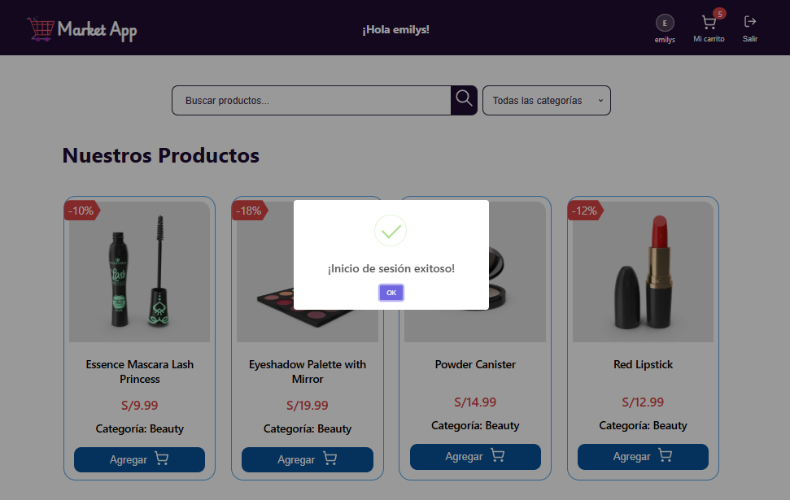
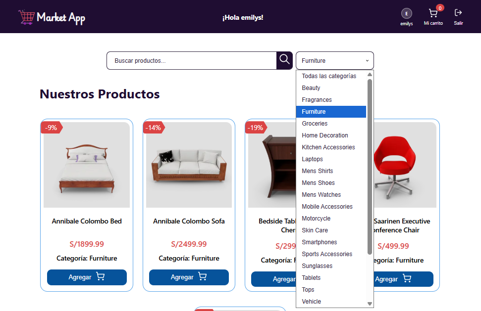
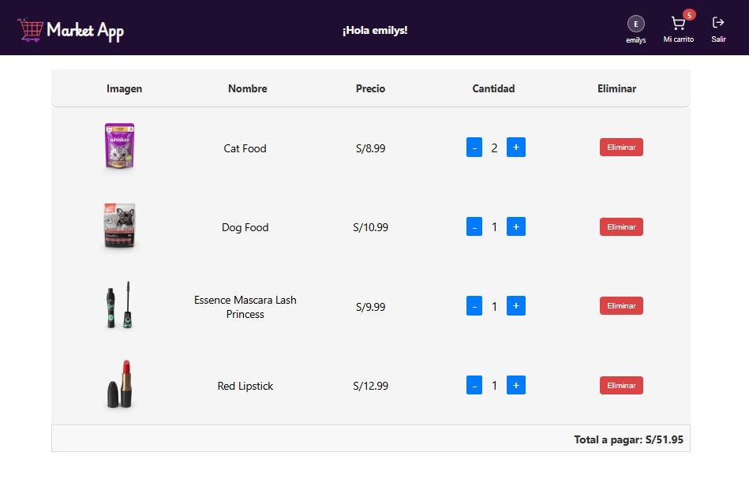
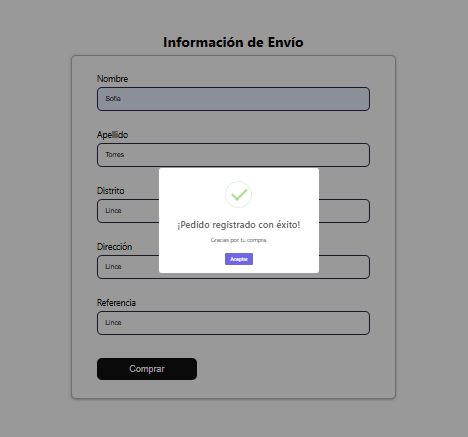
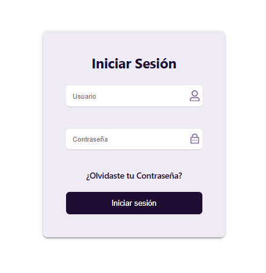
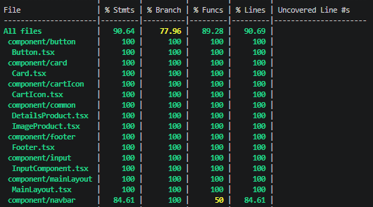
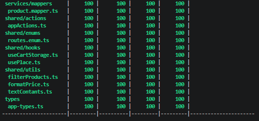

# Market App

Aplicación de comercio electrónico desarrollada con React y TypeScript. Permite explorar productos, filtrarlos por categorías, gestionar un carrito de compras y completar pedidos con formularios validados. Enfocada en modularización, tipado fuerte y pruebas automatizadas con Jest y React Testing Library.

<div align="center">


| Filtrado por Categorías | Carrito de Compras |
| :---: | :---: |
|  |  |

| Pedido Exitoso | Inicio de Sesión |
| :---: | :---: |
|  |  |

</div>

## Funcionalidades

- **Renderizado dinámico:** carga de productos mediante integración con una API.
- **Buscador de productos:** filtrado en tiempo real.
- **Filtrado por categorías:** selección sincronizada con la interfaz.
- **Carrito de compras:** agregar, eliminar y modificar cantidades.
- **Formularios de usuario:** validación de datos y control de acceso.
- **Arquitectura modular:** componentes reutilizables y separación de responsabilidades.

## Flujo de trabajo

El desarrollo siguió un flujo basado en **feature branches** con revisión de código por parte de un especialista de NTT Data. Cada funcionalidad se desarrolló en una rama independiente y se integró a `main` mediante **Pull Requests** revisados antes de su aprobación.

```text
main
 ├── feature/react-fundamentos          → PR #12
 │    └── feature/react-implementation  → PR #13
 │         └── feature/pruebas-unitarias
 │              └── feature/proyecto-integrador
 │                   └── refactor-proyecto-integrador  → PR #19
```

| # | Rama | Descripción | PR |
| :---: | :--- | :--- | :---: |
| 1 | `feature/react-fundamentos` | Base del proyecto con React | [#12](https://github.com/sofia-torres-v/BOOTCAMP-FRONTEND-REACT-NTT/pull/12) |
| 2 | `feature/react-implementation` | Implementación de componentes y lógica | [#13](https://github.com/sofia-torres-v/BOOTCAMP-FRONTEND-REACT-NTT/pull/13) |
| 3 | `feature/pruebas-unitarias` | Pruebas automatizadas con Jest y RTL | — |
| 4 | `feature/proyecto-integrador` | Integración de todas las funcionalidades | — |
| 5 | `refactor-proyecto-integrador` | Refactorización y mejoras finales | [#19](https://github.com/sofia-torres-v/BOOTCAMP-FRONTEND-REACT-NTT/pull/19) |

> Cada rama representó una etapa del bootcamp, permitiendo avanzar de forma incremental con feedback continuo.

## Credenciales de prueba

| Campo | Valor |
| :--- | :--- |
| Usuario | `emilys` |
| Contraseña | `emilyspass` |

> Estas credenciales dependen de la disponibilidad del servicio de autenticación.

## Tecnologías

| Tecnología | Uso |
| :--- | :--- |
| **React** | Interfaces mediante componentes funcionales |
| **TypeScript** | Tipado estático |
| **Vite** | Desarrollo y compilación |
| **Jest** | Pruebas automatizadas |
| **React Testing Library** | Pruebas desde la perspectiva del usuario |
| **Context API + Reducers** | Estado global y transiciones de estado |
| **CSS** | Estilizado de la interfaz |

## Estructura del proyecto

```text
📦 BOOTCAMP-FRONTEND-REACT-NTT
├── 📁 src
│   ├── 📁 assets              # Imágenes del proyecto
│   ├── 📁 component
│   │   ├── 📁 button
│   │   │   ├── 📁 __test__
│   │   │   └── button.css
│   │   ├── 📁 footer
│   │   ├── 📁 input
│   │   ├── 📁 mainLayout
│   │   └── 📁 navbar
│   ├── 📁 context
│   │   ├── 📁 __test__
│   │   ├── appContext.tsx
│   │   └── cartContext.tsx
│   ├── 📁 domain
│   │   ├── appState.domain.ts
│   │   ├── category.domain.ts
│   │   └── product.domain.ts
│   ├── 📁 hoc
│   ├── 📁 mocks
│   ├── 📁 pages
│   │   ├── 📁 home
│   │   └── 📁 products
│   ├── 📁 reducer
│   │   ├── 📁 __test__
│   │   ├── appReducer.tsx
│   │   └── cartReducer.tsx
│   ├── 📁 services
│   │   ├── 📁 api
│   │   ├── product.service.ts
│   │   └── 📁 mappers
│   ├── 📁 shared
│   │   ├── 📁 action / __test__
│   │   ├── 📁 hooks / __test__
│   │   └── 📁 utils
│   ├── 📁 types
│   ├── 📁 styles
│   ├── App.tsx
│   └── main.tsx
└── README.md
```

## Pruebas automatizadas

El proyecto utiliza **Jest** y **React Testing Library** para validar componentes, contextos, reducers, acciones y hooks personalizados. Los archivos de prueba se encuentran en las carpetas `__test__` dentro de cada módulo.

### Cobertura de código

<div align="left">


</div>

| Métrica | Cobertura |
| :--- | :---: |
| **Statements** | 90.64% |
| **Branches** | 77.96% |
| **Functions** | 89.28% |
| **Lines** | 90.69% |

> Cobertura objetivo: **> 70%** ✅

## Instalación y uso

### 1. Clonar el repositorio

```bash
git clone https://github.com/sofia-torres-v/BOOTCAMP-FRONTEND-REACT-NTT.git
cd BOOTCAMP-FRONTEND-REACT-NTT
```

### 2. Instalar dependencias

```bash
npm install
```

### 3. Ejecutar en modo desarrollo

```bash
npm run dev
```

### 4. Ejecutar las pruebas

```bash
npm test -- --coverage
```

> Consulta la sección `scripts` de `package.json` para ver todos los comandos disponibles.

---

**Desarrollado por [Sofía Torres](https://github.com/sofia-torres-v)** ✨
